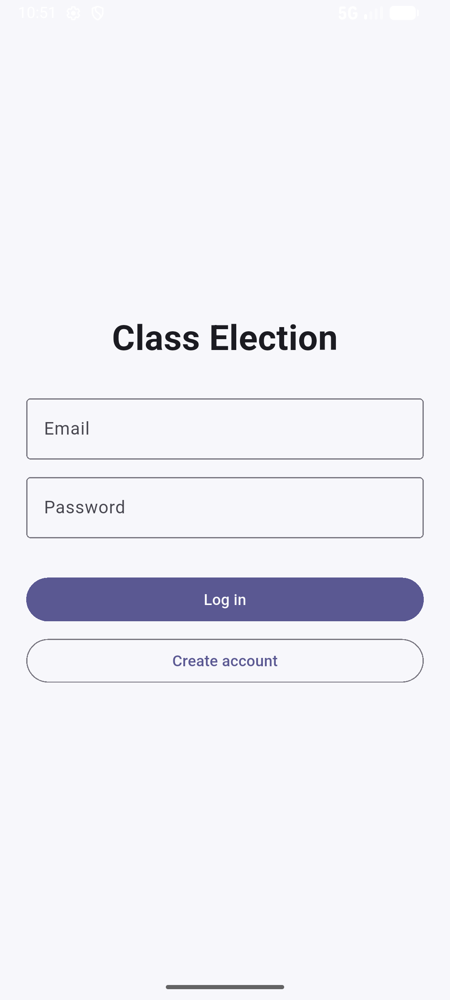
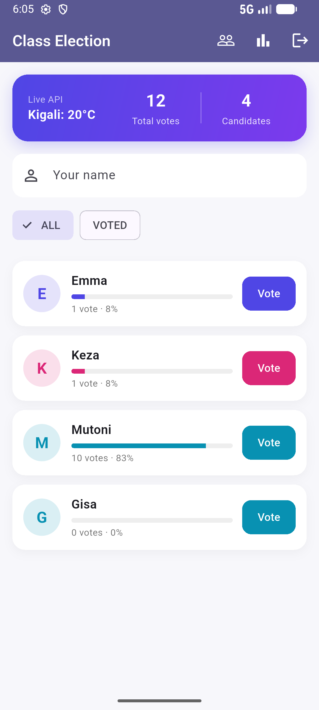
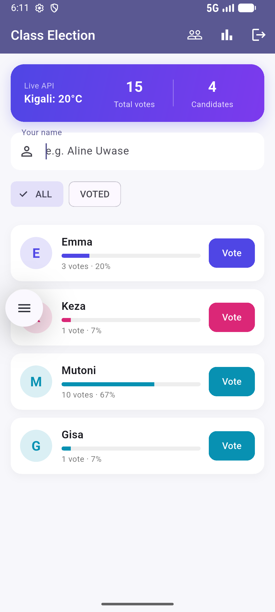

# Class Election

A beautiful app to run a class election live. Every voter can log in, cast their vote, and see the results update instantly on every phone.

## Download
[Download the latest APK](https://github.com/Emmalise1/class_election-/releases/latest) (for Android phones)

## Features
- Create an account and log in securely.
- Add new candidates with profile photos.
- Cast a vote (one vote per person).
- Live results with percentages, winner detection, and tie handling.
- Weather API integration.

## Screenshots
| Login | Voting                         | Results                          |
|---|--------------------------------|----------------------------------|
|  |  |  |

## How it's built
- Flutter, with Provider for state management
- Firebase Authentication and Cloud Firestore
- Cloudinary for photo uploads
- Open-Meteo API
- Four layers: models, repositories, state, screens

## Author
Iza Kuradusenge Emma Lise: [GitHub](https://github.com/Emmalise1)