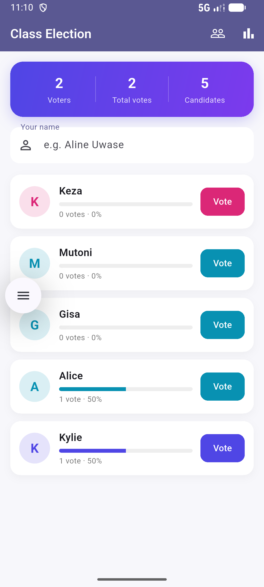
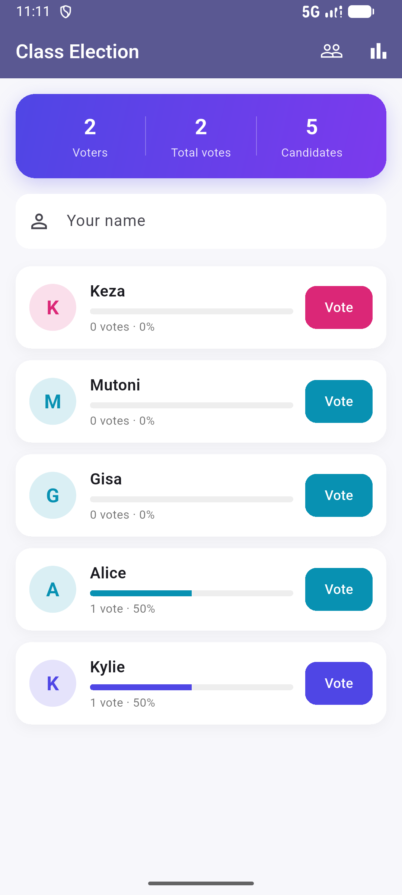
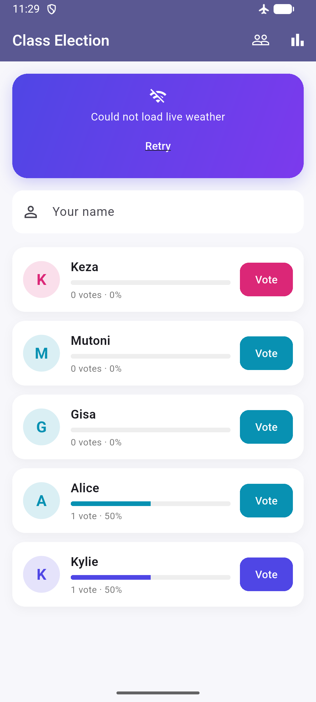

# Class Election

A beautiful Class Election app. My data is now saved on the phone with shared_preferences, so nothing is lost when the app closes, and it shows the live Kigali weather from the Open-Meteo API.

## Screenshots

